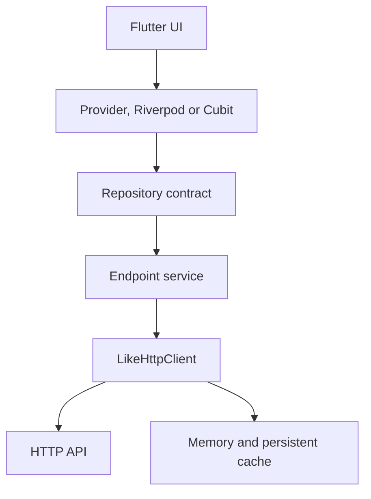
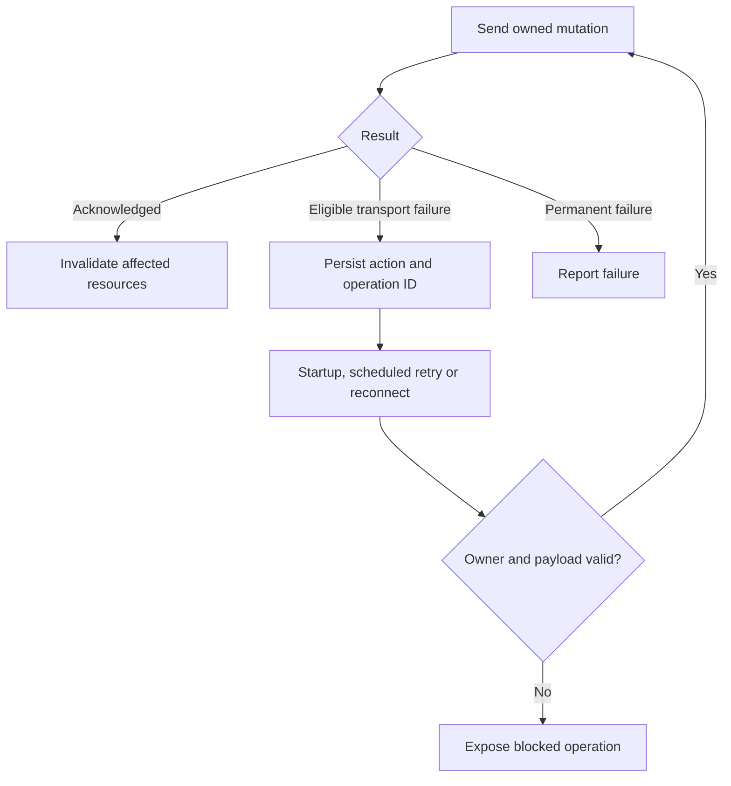

# LIKE — Link Intelligent Kernel Engine

[](https://pub.dev/packages/like)
[](https://github.com/AjayJasperJ/like/actions/workflows/ci.yml)
[](https://github.com/AjayJasperJ/like/actions/workflows/device-flows.yml)
[](LICENSE)

Flutter networking, caching and state coordination built on Dio. Use LIKE behind
an injectable service and repository, then present the results with Provider,
Riverpod, BLoC/Cubit or Flutter's own state primitives.

LIKE renders API-driven Flutter interfaces. Rendering arbitrary HTML, CSS and
JavaScript requires a WebView or browser engine.

## Contents

- [Latest updates](#latest-updates)
- [Features](#features)
- [Installation](#installation)
- [1. Initialization](#1-initialization)
- [2. Services and repositories](#2-services-and-repositories)
- [3. State management and UI](#3-state-management-and-ui)
- [4. Authentication and session ownership](#4-authentication-and-session-ownership)
- [5. Cache and mutation flows](#5-cache-and-mutation-flows)
- [6. Connectivity and notifications](#6-connectivity-and-notifications)
- [7. Diagnostics and development tools](#7-diagnostics-and-development-tools)
- [8. Media, uploads and WebSockets](#8-media-uploads-and-websockets)
- [Complete example apps](#complete-example-apps)
- [Platform support and testing](#platform-support-and-testing)
- [Documentation and contributing](#documentation-and-contributing)

## Latest updates

The repository's **2.4.0** update adds:

- Account/environment scopes for requests, caches and queued mutations.
- Durable multipart replay, scheduled retries, stable operation IDs and queue controls.
- Shared cancellable queries, resource-tag invalidation, optimistic updates and pagination.
- Passive slow API-path detection and bounded, payload-free request traces.
- Conservative diagnostic redaction and reproducible synthetic failure scenarios.
- Three separate public-API shops using Provider, Riverpod and BLoC/Cubit.
- Browser tests, native builds, Android/iOS device flows, minimum-SDK checks and release automation.
- Optional typed code generation for a documented OpenAPI 3.0 JSON subset.

See the [changelog](CHANGELOG.md) for fixes and migration details. A repository
version is not proof that the matching version has been published to pub.dev.

The slow-connection notification API includes `LikeToastConfig.slowInternet`
and the independent `Like.showSlowInternetToasts` toggle.

## Features

| Area | Included behavior |
| --- | --- |
| HTTP | GET, POST, PUT, PATCH, DELETE and multipart through injectable `LikeHttpClient` |
| Request policy | Cancellation, in-flight deduplication, scoped clients and per-request overrides |
| Response handling | `LikeApiResult<T>`, typed mapping, custom envelope unpackers and structured `LikeError` |
| Caching | L1 memory, persistent Hive cache, stale-while-revalidate and ETag/304 validation |
| Cache coordination | Scope/origin isolation, resource tags and explicit invalidation |
| Authentication | Token/API-key providers, shared refresh and deliberate logout callbacks |
| Offline actions | Opt-in persistence, owner checks, durable payloads, bounded retry and manual recovery |
| Reactive queries | Snapshots/streams, cancellation, stale-result guards and reconnect refresh |
| UI state | Loading, success, refreshing, stale data, error, exception and idle states |
| Mutations and lists | Layered optimistic reconciliation/rollback; deduplicated pages and failed-page retry |
| Connectivity | Interface/internet/server diagnostics and passive per-origin quality measurements |
| Diagnostics | Sanitized logs, request source/timing/status/retry traces and debug mock scenarios |
| Media and realtime | Managed image cache, image widget and WebSocket lifecycle/pipeline integration |
| Testing | Public testing entry point, injectable transport and complete example flow tests |

## Installation

The 2.4.0 source requires **Flutter 3.44.1 / Dart 3.12 or newer**.

For the latest published version:

```sh
flutter pub add like
```

Check the published version before following newer APIs. To evaluate the merged
2.4.0 source before publication, pin this repository revision instead:

```yaml
dependencies:
  flutter:
    sdk: flutter
  like:
    git:
      url: https://github.com/AjayJasperJ/like.git
      ref: 34c31c2b8b93a7c5587a0883e6cd4da9421ece8a
```

Then run `flutter pub get` and import:

```dart
import 'package:like/like.dart';
```

Android apps need Internet permission in the release manifest. Browser deployments
need an API that permits their origin through CORS. Keep TLS verification enabled
in production; browser certificate handling is controlled by the browser.

## 1. Initialization

Initialize storage and networking before issuing requests. The optional `Like`
root coordinates notification hooks and a developer-tool wrapper.

```dart
import 'package:flutter/material.dart';
import 'package:like/like.dart';

Future<void> main() async {
  WidgetsFlutterBinding.ensureInitialized();
  await LikeService.init(
    config: LikeConfig(
      projectName: 'my_app',
      baseUrl: 'https://dummyjson.com',
    ),
  );
  runApp(
    const Like(
      showConnectivityToasts: false,
      child: MaterialApp(home: Scaffold(body: Text('LIKE is ready'))),
    ),
  );
}
```

Use a stable `projectName` to namespace application storage. To configure a custom
response envelope, set `LikeConfig.unpacker` to `DefaultLikeUnpacker` or your own
`LikeUnpacker`. Plain public JSON APIs do not require a custom envelope.

## 2. Services and repositories

Keep endpoint mapping in a service and application operations behind a repository
contract. Pass `CancelToken` through every boundary.

```dart
class Product {
  final int id;
  final String title;
  const Product(this.id, this.title);

  factory Product.fromJson(dynamic json) =>
      Product(json['id'] as int, json['title'] as String);
}

class ProductService {
  final LikeHttpClient http;
  const ProductService(this.http);

  Future<LikeApiResult<Product>> getProduct(int id, CancelToken token) =>
      http.get('/products/$id', cancelToken: token).mapSync(Product.fromJson);
}

abstract interface class ProductRepository {
  Future<LikeApiResult<Product>> getProduct(int id, CancelToken token);
}

class ApiProductRepository implements ProductRepository {
  final ProductService service;
  const ApiProductRepository(this.service);

  @override
  Future<LikeApiResult<Product>> getProduct(int id, CancelToken token) =>
      service.getProduct(id, token);
}

// Compose once, outside widget build methods.
final repository = ApiProductRepository(ProductService(LikeClient()));
```

`LikeApiResult` represents expected API failures as values. Inspect `isSuccess`,
`data` and `error`; a failed result does not automatically become a Riverpod
`AsyncError` or a thrown exception. Use `mapSync` for synchronous mapping and
`mapAsync` for supported isolate-based mapping. `LikeBaseApiService` also provides
an injectable base service if you prefer inheritance.

For separate API modules, create `LikeClient.scoped(LikeClientConfig(...))` with
its own base URL/auth policy. The creator owns disposal of scoped clients.
Use `LikeRequestConfig` for a one-call timeout, origin, tags or policy override.

## 3. State management and UI



Services and repositories do not import presentation libraries. Inject the
repository into the state owner so tests can replace it with a fake.

For a shared reactive query over the repository above:

```dart
final client = LikeClient();
final query = LikeQuery<Product>(
  action: (token) => repository.getProduct(1, token),
  scope: () => client.sessionScope.key,
  origin: client.origin,
  tags: const ['products'],
  sessionChanges: client.sessionChanges,
);

final subscription = query.watch().listen((state) {
  // Publish/render state using your chosen state-management library.
});
await query.refresh();

// When the owning feature closes:
await subscription.cancel();
await query.dispose();
```

A new subscription receives the current snapshot. Refresh cancels superseded
work; session changes clear stale state. Matching resource invalidations and
origin restorations schedule refreshes. Dispose owned queries and subscriptions.

| Presentation style | Building blocks | Working source |
| --- | --- | --- |
| Provider / ChangeNotifier | `LikeStateMixin`, `LikeNotifierState`, `LikeBuilder` | [Provider shop](examples/provider_app) |
| Riverpod | Repository providers, Notifier or query streams with `ref.onDispose` | [Riverpod shop](examples/riverpod_app) |
| BLoC / Cubit | Immutable state snapshots and explicit subscription/close ownership | [BLoC shop](examples/bloc_app) |
| Flutter primitives | `StreamBuilder`, `ValueListenableBuilder`, `LikeWhen` | [State-management guide](documents/state_management.md) |

Existing notifier-based UI helpers remain available:

- `LikeBuilder` and `LikeSliverBuilder`: render a notifier's lifecycle states.
- `LikeSelector` and `LikeSelectorSliver`: select part of a provider's state.
- `LikeMultiBuilder` and `LikeMultiSliverBuilder`: combine multiple states.
- `LikeWhen`: render an existing `LikeStateResponse` snapshot.
- `updateNotifier`: configurable action feedback and haptics.
- `likeWhenNotifier`: manually controlled side effects without built-in toast feedback.

Use `LikeOptimisticStore` for overlapping optimistic writes with reconciliation
and rollback. Use `LikePagedQuery` for separate page storage, identity-based item
deduplication, cancellation and retrying a failed page. See
[architecture](ARCHITECTURE.md) and [state-management examples](documents/state_management.md).

## 4. Authentication and session ownership

Provide token access and refresh functions through `LikeAuthConfig`, supplied to
`LikeConfig`, a scoped client, or the `Like` root. The application stores tokens
and defines logout behavior; do not hard-code credentials in configuration.

```dart
// tokenStore is your application's secure session store.
final auth = LikeAuthConfig(
  getToken: () => tokenStore.readAccessToken(),
  refreshToken: () => tokenStore.refreshAndSaveAccessToken(),
  onLogout: ({int? statusCode, bool force = false}) async {
    await tokenStore.clear();
    LikeClient().setSessionScope(const LikeSessionScope());
  },
);
```

After login, identify the account independently of its rotating access token:

```dart
final client = LikeClient();
client.setSessionScope(
  const LikeSessionScope(environment: 'production', accountId: 'customer-42'),
);
final profile = await client.get('/auth/me', withAuth: true);

// After clearing credentials on logout:
client.setSessionScope(const LikeSessionScope());
```

Scope changes cancel old work and prevent another account's queued operations
from replaying. Protected anonymous operations do not cache or queue. Set
`withAuth: true` explicitly on protected requests; supplying auth callbacks alone
does not make every endpoint authenticated.

## 5. Cache and mutation flows

| Layer/policy | Behavior |
| --- | --- |
| L1 | Reuse memory responses within the request registry |
| L2 | Persist supported response payloads in Hive |
| SWR | Serve eligible stale data while refreshing in the background |
| ETag/304 | Revalidate using server freshness metadata |
| Resource tags | Invalidate related cached reads and active query observers |

Reads can opt into SWR and resource tags:

```dart
final products = await LikeClient().get(
  '/products',
  staleWhileRevalidate: true,
  requestConfig: LikeRequestConfig(cacheTags: const ['products']),
);
```

Successful mutations can invalidate the same resource:

```dart
final result = await LikeClient().post(
  '/products/add',
  body: {'title': 'Demo product'},
  requestConfig: LikeRequestConfig(invalidates: const ['products']),
);
```

Cache use depends on configured policies, freshness, scope and request options.
Offline/error fallback policies are configurable; they are not a guarantee that
all failed requests return cached data. See the actual
[interceptor order](documents/interceptor_pipeline.md).

### Offline mutations are opt-in

```dart
final result = await LikeClient().post(
  '/orders',
  body: {'productId': 42, 'quantity': 1},
  withAuth: true,
  offlineSync: true,
  requestConfig: LikeRequestConfig(invalidates: const ['orders']),
);
```

A queued action is pending work, **not a confirmed server success**. Treat its
`offlineQueued` error/state separately in your UI.



Inspect `client.offlineTasks`, observe `client.offlineQueue?.taskChanges`, and use
`retryTask(key)` / `cancelTask(key)` on the queue for user-driven recovery. Failed
and blocked entries remain inspectable. Legacy ownerless entries require review.
Retries use bounded attempts, backoff and applicable `Retry-After` metadata.

Stable `Idempotency-Key` values survive replay, but preventing duplicate server
writes requires backend support for that key. The default durable multipart
snapshot limit is 10 MiB; larger uploads need an application-owned codec/storage
policy. Scheduling works while the process is running; this is not a guaranteed
OS background-job service after termination.

## 6. Connectivity and notifications

Connectivity diagnostics distinguish an interface being available, wider Internet
reachability and availability of a particular API origin. Use
`client.checkServerReachability(force: true)` for an explicit client-origin check.
An HTTP error response still establishes that its server is reachable.

Configure existing notifications through `LikeConfig.toastConfig` or the `Like`
root's `toastConfig`:

```dart
final notifications = LikeToastConfig(
  connected: (message) => showAppToast(message),
  disconnected: (message) => showAppToast(message),
  resync: (message, progress) => showSyncProgress(message, progress),
  actionQueued: (message) => showAppToast(message),
  cacheUse: (message) => showAppToast(message),
  swrUse: (message) => showAppToast(message),
);
```

The functions above are application callbacks. A custom callback replaces LIKE's
built-in feedback for its event. Configure callbacks when wrapping MaterialApp,
using your app's messenger key or toast service; default ScaffoldMessenger
notifications require a suitable ancestor context.

### Slow API-path detection

Subscribe to `LikeNetworkQualityMonitor.shared.stream` and cancel the subscription
when its owner closes. The default monitor classifies an origin as slow after two
consecutive requests taking at least two seconds, timing out, or transferring a
large response below 32 KiB/s. Cached responses and cancellations are excluded.

This uses real request measurements and performs no extra speed-test downloads.
Server processing time can affect the result: it measures the API path, not
calibrated device-wide bandwidth. See [thresholds and configuration](documents/network_privacy_platforms.md).

Configure the matching toast callback alongside the connectivity hooks:

```dart
final notifications = LikeToastConfig(
  slowInternet: (message) => showAppToast(message),
);
```

The root notifies once when an origin enters slow quality, suppresses repeated
slow samples and rearms after that origin recovers. A custom callback replaces
the default warning. Set `Like(showSlowInternetToasts: false, child: app)` to
disable slow notifications without disabling measurements. The default toast
requires a ScaffoldMessenger ancestor; when wrapping MaterialApp, supply your
app's callback. Custom monitor instances remain caller-owned.

## 7. Diagnostics and development tools

`LikeDiagnostics` provides bounded request traces containing source, status,
timing, retry counts and auth-replay metadata without request/response payloads.
`LikeLogger` sanitizes diagnostic copies before publication; release request and
response bodies are omitted. Sensitive nested fields are redacted, and opaque
strings are conservatively omitted. Application responses remain usable.

Redaction does not encrypt caches or hide data from someone controlling the
device. The raw `LikePipeline` is an application data bus, not a safe export
stream. Unversioned historical logs are filtered from exports, not erased from
the filesystem. See [privacy behavior](documents/network_privacy_platforms.md).

The optional [DevTool companion](https://github.com/AjayJasperJ/like_devtool)
provides request inspection, safe previews, queue recovery controls and synthetic
scenarios. Access depends on that repository's permissions; it is not bundled
into the core dependency. Integrate a compatible version only in development.

`MockController`, `MockRule` and `LikeMockScenario` support persisted synthetic
responses, latency, bounded uses, failures and recovery presets. For example:

```dart
await LikeMockScenario.failureThenSuccess('/products', status: 429).install();
```

Scenario installation is disabled in release builds. Use synthetic data and
`exportSafe()` when sharing scenarios; do not include real credentials.

Optional typed generation is documented in [OpenAPI generation](documents/openapi_generation.md).
Unsupported schema shapes are rejected; this is not a complete OpenAPI implementation.

## 8. Media, uploads and WebSockets

- **Images:** `LikeCacheImage` supplies placeholders/error widgets over managed
  caching. `AppCacheManager` stores image bytes unchanged and supports pruning
  and explicit clearing. These caches are not encrypted. Review URL normalization
  before using account-sensitive image URLs.
- **Multipart:** `client.multipart(...)` supports form fields/files; native file
  paths are not available on web. Use browser-compatible file bytes and an
  explicit replay policy for uploads that must survive offline recovery.
- **WebSockets:** `LikeWebSocketClient` provides serialized lifecycle operations,
  reconnect, heartbeats, auth resolution, message streams and pipeline integration.
  Browser handshake restrictions still apply. Cancel owned subscriptions and
  dispose the socket client when the feature closes.

## Complete example apps

| App | State owner | Source |
| --- | --- | --- |
| Provider shop | ChangeNotifier / Provider | [examples/provider_app](examples/provider_app) |
| Riverpod shop | Riverpod Notifier | [examples/riverpod_app](examples/riverpod_app) |
| BLoC shop | Cubit / BlocBuilder | [examples/bloc_app](examples/bloc_app) |

All three use [DummyJSON](https://dummyjson.com) without an internal server or
secret API key. The public demo account is **emilys / emilyspass**.

Browse → search/paging → product details → sign in → persistent account-scoped
cart → quantity changes → simulated checkout/receipt → sign out.

Each app includes restore/refresh, retry, slow-connection hints and safe
diagnostics. Tokens use secure storage; carts use Hive. DummyJSON writes are
simulated: checkout does not charge money or create a real purchase.

```sh
cd examples/provider_app # or riverpod_app / bloc_app
flutter pub get
flutter run
flutter run -d chrome
flutter test
flutter build web --release
flutter build apk --release
```

The [Public API shop apps workflow](.github/workflows/shop-apps.yml) uploads
`like-provider-release-apk`, `like-riverpod-release-apk` and
`like-bloc-release-apk`, plus web builds. Download artifacts from a successful
[Actions run](https://github.com/AjayJasperJ/like/actions/workflows/shop-apps.yml).
APKs are retained for seven days and use test signing for evaluation. Production
store builds need your own protected signing configuration.

An `apps-v*` tag publishes the three APK assets to a GitHub release after its
checks pass. Package publication uses a separate `v<version>` workflow and
requires the owner to configure pub.dev automated publishing. Merging a PR does
not publish a package or create a tagged release. See [release setup](documents/releases.md).

The legacy [example/](example) app and [server/](server) remain available for
additional integration demonstrations; they are not required by the three shops.

## Platform support and testing

| Target | Repository verification |
| --- | --- |
| Web | Headless Chrome HTTP/model/widget flows, browser storage tests and release compilation |
| Android | Native build, emulator UI flows and live production-repository integration |
| iOS | Simulator build, isolated UI flows and live production-repository integration |
| Linux / macOS / Windows | Host VM tests and native example compilation |

These levels are different: compilation does not prove every plugin works on a
physical device, and Chrome coverage does not establish Safari/Firefox parity.
Browser CORS, TLS, storage quotas and background timer limits still apply.
Native certificate pinning cannot override browser certificate policy.

CI tests minimum Flutter 3.44.1 separately from current stable. Device jobs use
bounded startup recovery only before tests connect; assertion failures are not
retried. Temporary downloaded SDKs/dependency caches are cleaned at completion,
with one-hour job limits and disposable hosted runners.

For local core validation:

```sh
flutter pub get
flutter test
cd server && dart pub get && cd ..
cd example && flutter pub get && cd ..
flutter analyze
```

Root analysis includes the legacy server tests: resolve dependencies in `server/`
and `example/` first, as CI does. Full browser HTTP tests also require the local
fixture from `tool/browser_test_server.py`; follow
[the package workflow](.github/workflows/ci.yml) for the complete command sequence.

Import `package:like/testing.dart` in tests to access transport adapters, cache,
queue, registry and pipeline boundaries without private `src/` imports. Prefer
injected fakes for unit tests and controlled adapters/fixtures for transport tests.

## Documentation and contributing

| Guide | What it covers |
| --- | --- |
| [Architecture and source map](ARCHITECTURE.md) | Responsibilities, implementation paths and tests |
| [State management](documents/state_management.md) | Provider, Riverpod, Cubit and other integration patterns |
| [Interceptor pipeline](documents/interceptor_pipeline.md) | Actual request/response ordering |
| [Multiple clients](documents/multi_client_support.md) | Scoped clients and per-request policies |
| [Privacy and platforms](documents/network_privacy_platforms.md) | Redaction, quality measurements and platform constraints |
| [OpenAPI generation](documents/openapi_generation.md) | Supported schema subset and generated policies |
| [CI troubleshooting](documents/ci_troubleshooting.md) | Diagnosed runner failures and verification |
| [Releases](documents/releases.md) | Publishing identity, versions and APK artifacts |
| [Implementation report](documents/implementation_report.md) | Implementation/evidence map and boundaries |

Redis belongs behind your HTTP API if your backend needs it; it is not a mobile
state-management layer or a bundled LIKE backend dependency. GetX, MobX and Redux
integration patterns are documented, but dedicated example apps/adapters are
currently provided for Provider, Riverpod and Cubit.

Report reproducible bugs in [this repository's issues](https://github.com/AjayJasperJ/like/issues).
See [CONTRIBUTING.md](CONTRIBUTING.md) for contribution guidelines and
[LICENSE](LICENSE) for the MIT license.
