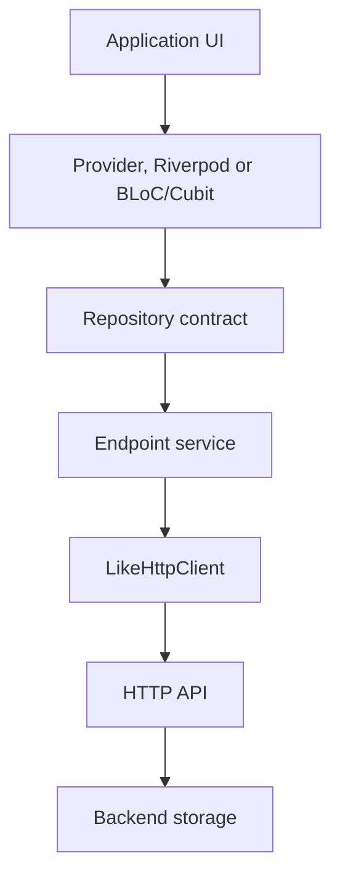
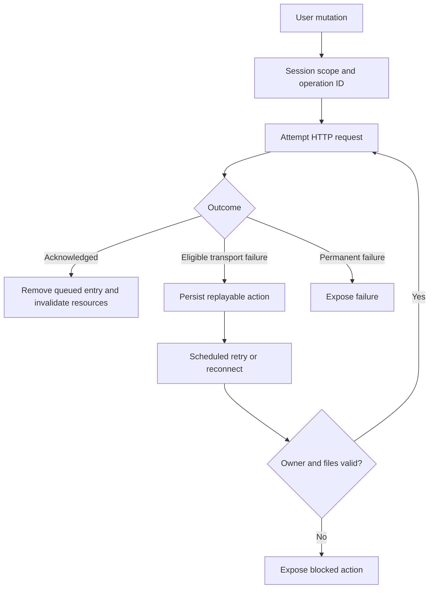

# Pending tasks and implementation flow

Status updated: 31 October 2026. This is the implementation checklist, not a claim
that every capability below is missing from LIKE. Existing capabilities need the
specific hardening or extension described here.

## Completed increments

- [x] Encode typed query values to prevent delimiter collisions.
- [x] Preserve newly cached payload types and retain legacy JSON cache reads.
- [x] Keep request registry disposal terminal.
- [x] Add injectable LikeHttpClient and a shared posts repository contract.
- [x] Provide Provider, Riverpod and Cubit examples and boundary tests.
- [x] Expose main networking components through package:like/testing.dart.
- [x] Run core, server and example tests, strict analysis, web compilation and
  publication dry-run in GitHub Actions.
- [x] Upload coverage reports for one day; remove temporary SDK/dependencies at
  completion; retain a one-hour job timeout.
- [x] Document state management and map implementation/test source paths.

Evidence: [passing architecture workflow](https://github.com/AjayJasperJ/like/actions/runs/41220924576).
This is a historical validation run, not the status of every later commit.

## Current increment in review

[PR #3](https://github.com/AjayJasperJ/like/pull/3) implements NET-01 origin
identity, passive slow API-path detection, conservative LikeLogger redaction and
expanded browser/native CI. Validation is in progress; these are not all marked
complete yet. DevTool raw-traffic redaction, account isolation, device-runtime
integration and the remaining offline/session work stay pending.

Additional acceptance criteria:

- NET-03: repeated slow evidence, recovery, origin isolation, optional throughput
  estimates, cache/cancellation exclusions and bounded monitor state are tested.
- PRIVACY-02: debug/release policies redact diagnostic copies without changing
  application responses; all DevTool/export consumers still need an audit.
- WEB-01: headless browser HTTP/CORS, cache/ETag persistence, timeout, cancellation,
  core/model/widget tests and release compilation pass.
- PLATFORM-01: native VM suites and Linux/macOS/Windows/Android/iOS-simulator builds
  pass. These are not equivalent to Android/iOS runtime device tests.

## Next implementation order

| Order | ID | Pending work | Completion criteria |
| --- | --- | --- | --- |
| 1 | NET-01 | Effective-origin request identity | Same path/query on different request-level origins cannot share deduplication, L1 or ETag state; regression tests cover scoped and overridden origins. |
| 2 | SESSION-01 | Account/environment isolation | Cache and queued actions carry an explicit session scope; switching accounts cannot reveal cached data or replay another account's actions. |
| 3 | SYNC-01 | Offline retry scheduler | Eligible failed entries wake at nextAttemptAt while running; startup resumes eligible work; timers cancel cleanly; no overlapping drains. |
| 4 | SYNC-02 | Durable multipart uploads | Persist serializable fields and durable file references/bytes; reconstruct replay bodies; report unavailable files; verify restart recovery. |
| 5 | SYNC-03 | Mutation idempotency | Persist an operation key across retries; document required backend support; distinct user actions remain distinct. |
| 6 | SYNC-04 | Queue recovery controls | Expose pending/running/blocked/failed states, manual retry/cancel and failure details; terminal failures remain inspectable. |
| 7 | AUTH-01 | Refresh resilience | Concurrent 401s share refresh; throwing hooks settle requests; logout happens deliberately; multipart retry reconstructs the body. |
| 8 | NET-02 | Retry policy | Parse seconds and HTTP-date Retry-After; add bounded jitter; retry only eligible failures; cancellation interrupts delays. |
| 9 | CACHE-01 | Resource invalidation | Resource tags invalidate relevant queries; active observers refetch without broad unrelated refreshes. |
| 10 | STATE-01 | End-to-end cancellation | Propagate CancelToken through example repository/service operations; disposal and replacement cancel transport in Riverpod and Cubit tests. |
| 11 | STATE-02 | Cross-framework refresh parity | Define explicit shared query subscriptions, reconnect behavior and invalidation for Riverpod/Cubit; test lifecycle and duplicate suppression. |
| 12 | PRIVACY-01 | Shared redaction policy | Configurable masking covers headers, query/body fields, logs and exported diagnostics; nested values and case variants are tested. |
| 13 | STATE-03 | Optimistic mutations | Snapshot, optimistic update, server reconciliation and rollback are tested, including overlapping writes. |
| 14 | PAGE-01 | Pagination hardening | Extend existing pagination with item-ID deduplication, failed-page retry, cursor completion and request cancellation tests. |
| 15 | DEV-01 | DevTool request explanations | Inspector shows request provenance, retry reason, cache layer and queue state; core and DevTool versions agree. |
| 16 | DEV-02 | Reproducible failure scenarios | Save/replay latency, 401, 429, outage and interrupted-upload scenarios without leaking credentials. |
| 17 | DOC-01 | Core/DevTool documentation alignment | Correct stale encryption/setup claims, document compatibility and validate examples. |
| 18 | CI-01 | Compatibility matrix | Test documented minimum and current supported Flutter versions, core/DevTool compatibility and appropriate platform builds. |
| 19 | CI-02 | Dependency/release automation | Automated update checks; version/changelog gates; approved release tags publish through configured pub.dev identity. |
| 20 | GEN-01 | Optional OpenAPI generation | Generate typed service/parser code with explicit cache/mutation policies; keep generation optional and test generated output. |

All rows above remain pending. Finish one independently testable increment before
marking it complete. Every change should name the trigger, observable behavior,
regression test and lifecycle/storage migration impact. Do not mark a whole area
complete because one example or happy-path test passes.

Redis is an optional future backend integration, outside the mobile state layer.
The bundled server uses SQLite. Dedicated GetX, MobX and Redux adapters/tests are
also optional future work; current documentation describes integration patterns.

## Current data flow

Dependencies are injected toward the data layer. Results flow back through the same
boundaries. Redis, if added, lives behind the HTTP API. The concrete LikeClient
owns network/cache behavior; presentation libraries do not own HTTP policy.

Current state-management differences:

| Behavior | Provider example | Riverpod example | Cubit example |
| --- | --- | --- | --- |
| Data dependency | PostsRepository | postsRepositoryProvider override | PostsRepository |
| Loading/errors | PaginatedNotifierState / LIKE helpers | AsyncValue wrapping ApiResult | LikeStateResponse |
| Mutation refresh | Explicit list reload | Caller invalidates page family | Caller invokes refresh/load |
| Latest completion wins | Existing LIKE pagination machinery | Provider-family lifecycle | Explicit generation guard |
| Dispose cancels HTTP end to end | Not guaranteed by the repository contract | Not implemented | Not implemented |
| Full reconnect/pipeline parity | Uses LIKE state helpers | Pending | Pending |

## Target offline mutation flow — pending

This target requires the SESSION/SYNC tasks above. Do not present it as current
behavior. HTTP acknowledgment plus a lost response can still duplicate a mutation
unless the backend honors the same idempotency key.

## Review and verification flow

1. Change the smallest responsible layer behind an injectable contract.
2. Add deterministic tests for success, failure, overlapping requests and disposal
   where those conditions apply.
3. Verify persisted format migrations when changing cache or queue data.
4. Run core/example/server suites, analysis, web build and publication validation.
5. Inspect coverage and relevant logs; retain explicit known limitations.
6. Update this checklist and the affected flow documentation after validation.

See [state management](state_management.md),
[actual interceptor order](interceptor_pipeline.md) and
[source/test map](../ARCHITECTURE.md).
