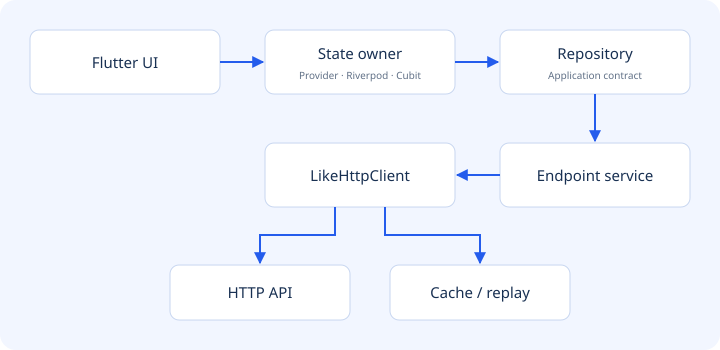

# Architecture & ownership

The application owns use cases and state. LIKE owns the configured transport,
cache and replay machinery.



## Responsibilities

| Layer | Owns | Must not own |
| --- | --- | --- |
| UI | Rendering and user intent | Tokens or HTTP retry rules |
| State owner | Immutable snapshots/loading and lifecycle | Endpoint parsing |
| Repository contract | Application operations | A presentation framework |
| Concrete repository | Data-source coordination and storage policy | Widgets |
| Endpoint service | Parameters and DTO mapping | Navigation/toasts |
| LikeHttpClient | Injectable HTTP boundary | Feature business rules |

Dependencies point toward contracts. Inject concrete implementations at startup;
replace those same boundaries with fakes in tests. Avoid constructing repositories,
clients or subscriptions on every widget build.

## Minimal boundary

```dart
import 'package:like/like.dart';

abstract interface class CatalogRepository {
  Future<LikeApiResult<Map<String, dynamic>>> product(int id, CancelToken token);
}

class CatalogService {
  final LikeHttpClient http;
  const CatalogService(this.http);
  Future<LikeApiResult<Map<String, dynamic>>> product(int id, CancelToken token) =>
      http.get('/products/$id', cancelToken: token).mapSync(
        (json) => Map<String, dynamic>.from(json as Map),
      );
}

class ApiCatalogRepository implements CatalogRepository {
  final CatalogService service;
  const ApiCatalogRepository(this.service);
  @override
  Future<LikeApiResult<Map<String, dynamic>>> product(int id, CancelToken token) =>
      service.product(id, token);
}
```

## Lifecycle rules

- The composition root creates a scoped client once and disposes it when its feature closes.
- A service never disposes a client supplied by another owner.
- State owners cancel subscriptions, queries and transport tokens they create.
- Riverpod disposal callbacks must capture dependencies before disposal; do not read a disposed `ref`.
- Do not dispose the shared global network-quality monitor when a screen closes.

The `examples/shop_shared` package contains domain/data/application/presentation
boundaries; three independent adapters own state with Provider, Riverpod and Cubit.
See [the repository architecture map](../../ARCHITECTURE.md) for source/test paths.
